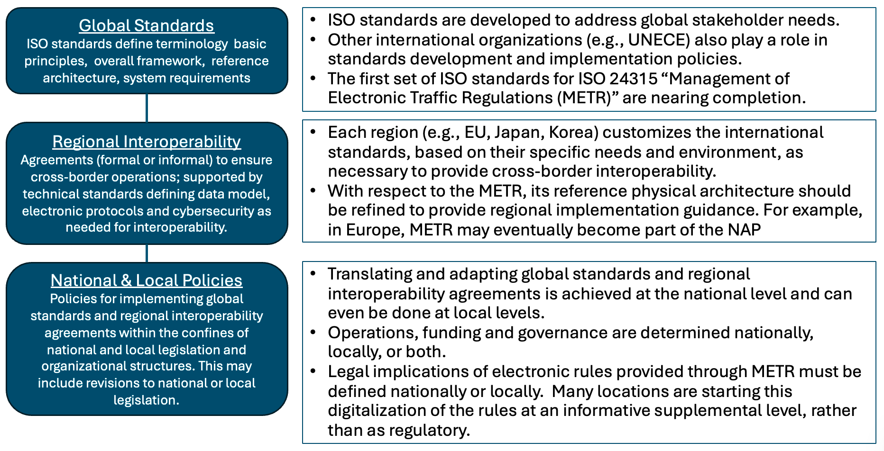

# Regional Guidance

## Introduction

### Purpose of this document

This document focuses on understanding METR's scope, deployment and usage scenarios, regional frameworks to support region-specific needs and environments, and stakeholder benefits, without delving into deep technical implementation details.

### Audience

This document is designed for a broad audience. The primary audience includes planners, decision makers, and end-user representatives such as fleet managers. The guide also serves as an introduction to METR and related issues for transportation infrastructure owners and operators, rule makers, original equipment manufacturers (OEMs), transportation service providers, navigation system developers, and emergency responders. Additionally, it serves as a valuable resource for policymakers, legal professionals, and public safety officials who are involved in transportation regulation and safety.

### Background

The ISO 24315 series establishes a standardized framework for the Management of Electronic Traffic Regulations (METR), aimed at providing trustworthy, authoritative, and machine-interpretable traffic regulations for surface transportation systems. This series supports the digital transformation of rules and regulations, enabling seamless integration with intelligent transport systems (ITS), automated driving systems (ADS), and connected vehicles. It is particularly relevant for automated vehicles operating at higher levels (e.g., SAE Level 3 or 5), where reliable access to digital regulations is essential for compliance and safety.

- **ISO/TS 24315-1**: Vocabulary for METR, defining key terms to ensure consistent understanding.
- **ISO/TR 24315-2**: Overview of operational concepts, user needs, and system functions and architecture.
- **ISO/TS 24315-3**: End-to-end requirements for the METR system of systems (SoS), covering regulation management, dissemination, and discrepancy reporting.
- **ISO/TS 24315-4**: Requirements for each component system within the METR SoS.

### Need for Regional Implementation Guidance

As METR systems become more widespread, regional implementation guides are essential to ensure interoperability across different jurisdictions. These guides provide a consistent framework that aligns with national and international standards while allowing for local customization. This complementary layered approach thus safely supports METR infrastructure and deployment across the METR ecosystem. 

<figure><figcaption>Three-tiered approach</figcaption></figure>

Without clear regional guidance, there is a risk of fragmented or incompatible systems that could undermine the effectiveness of METR, leading to potential safety issues, inefficiencies, and challenges in regulation enforcement.

## Scope of METR Systems

METR represents a groundbreaking approach to managing and distributing transportation regulations, such as speed limits, lane usage regulations, parking restrictions, and moderately dynamic controls (e.g., variable speed limits or work zone regulations). The system's primary purpose is to enable electronic dissemination of trustworthy rules and regulations, ensuring that all stakeholders, and their support systems, have access to current regulatory information. The system can also be used to support the distribution of non-regulatory information (e.g., warnings, advisories) in a trustworthy manner. Key scope elements include:

**Trust and Security**: Regulations are authenticated using certificates and signatures to prevent falsification.

**Regional Interoperability**: Deployment environments vary across the globe due to different regional needs. Within each region of vehicular mobility, METR will be associated with standardized protocols that provide interoperability within the geographic region (e.g., Europe).

**Standards Consistency**: METR is intended to enhance and update existing standards like DATEX II, TN-ITS, and TransModel, rather than replacing them.

**Machine-Interpretability**: Regulations are formatted for use by ADS, reducing human interpretation errors.

METR does not dictate the content of regulations but provides a framework for their management, including data governance, cybersecurity, and lifecycle processes.

## Reference architecture

METR operates as a system of systems (SoS), where components collaborate to manage the full lifecycle of electronic regulations as shown in Figure 1:

**Regulation Definition**: Authorities (e.g., infrastructure owners, road operators, emergency personnel) at various levels of hierarchy (e.g., national, regional, local) define regulations.

**Electronic Regulation Management**: Organizations enter the regulations, including the type of regulation, affected location(s), and validity periods into a **regulation system**. This will typically be performed with the use of tools to ensure proper geolocation of the regulation and to validate, certify, and sign the regulations.

**Consolidation and Dissemination**: Centralized or hierarchical servers collect the regulations from relevant authorities to form a consolidated view of available regulations in a **distribution system**. These regulations are then distributed (e.g., via publish/subscribe protocols) to end users (e.g., vehicles, apps) based on their needs.

**End-User Consumption**: **Consumer systems** (e.g., on-board a vehicle, a pre-trip planning application) determine the regulations needed and obtain them from the distribution system(s) with proper validity checks. The end-user system is then responsible for determining how to apply the applicability of the regulations to the current situation (e.g., based on location, time-of-day, weather, and other factors) and applying them as appropriate. For example an ADS might use this information to make vehicle control decisions while a driver information system might use this information to determine what information should be displayed to the driver.

**Discrepancy Reporting**: Any time two sources of information exist (e.g., a regulation within the METR system and a sign at the side of the road), there is a possibility of inconsistent information. METR is explicitly designed with a feedback loop so that any such inconsistencies can be reported and corrected in a timely fashion. Reports of these inconsistencies are submitted (e.g., by a vehicle that can automatically detect speed limit signs) to a **discrepancy reporting system**. This system consolidates reports from multiple users and notifies the appropriate regulation systems so that the inconsistencies can be investigated and corrected.

## Example Deployment Architectures

### Overview

A reference architecture provides a generic representation of how systems could be designed so that key interfaces can be identified and interoperability standards developed. However, each deployment will likely vary from the more theoretical reference architecture. This section presents some examples of how the reference architecture is likely to be deployed depending on various factors, including:

Jurisdictional complexity: If all regulations are issued by a single or small number of authorities, a single regulation system can more readily perform the collection role for the jurisdiction and may even be able to act as a distribution system. By comparison, complex regions with multiple levels of regulation-making hierarchy and multiple rule makers within each hierarchy will likely need to keep regulations distinctly separate from the collection and distribution of regulations.

Cross-border coordination: Jurisdictions that deal with heavy cross-border traffic (e.g., Europe) ideally will adopt regional policies and standards so that vehicles can seamlessly interoperate throughout the region. In this case, the different jurisdictions can more readily share system components (e.g., multiple jurisdictions can share a common regulation system).

Inter-regional coordination: Jurisdictions that do not adopt compatible policies and standards will create an operational boundary and will need to establish policies on how vehicles from foreign jurisdictions can enter and operate within its new environment. This distinct jurisdictional boundary will likely result in a distinct system boundary as well.

Scope of users of the system: METR is designed to support regulations for a variety of users, including general motor vehicles, regulated vehicles (e.g., heavy vehicles, buses, taxis), public-area mobile robots, etc. These regulations are often made by different rule makers but can have overlapping application (e.g., heavy vehicles still have to comply with most motor vehicle regulations)

Scope of regulations within the system: Early deployments are likely to focus on limited R&R sets (e.g., speed limits), but as the content of the METR systems expand, the number of rule makers will and more dynamic regulations are likely to be included making the system more complex.

Geographic scope of system: The number of regulations within a system will scale with geographic and population size, but most end-user systems will only need a small subset of the regulations at any point in time.

Funding for distribution: The distribution of regulations could be seen as providing an important public benefit, and funded by a public agency, or could be perceived to be more of an advanced feature for higher end vehicles and left to the private sector. The boundary between public and private sector involvement can impact boundaries between systems.

These factors can influence the deployment architecture for a region. Example deployment architectures can include any of the following or some sort of hybrid among them:

**Centralized System**: A single authority records, collects and distributes the regulations for an area; this can be ideal for small, uniform systems or for prototype deployments.

**Distributed Regulation-Making System:** A variety of authorities record regulations for an area while a single agency collects the regulations and distributes them.

**Distributed Regulation Management System:** A variety of authorities record regulations for an area, a single agency consolidates the regulations, and a third entity (often private) is responsible for delivery of the regulations to the end user.

**Distributed Regulation Management System with Service Discovery:** A variety of authorities record regulations for an area, each of these authorities registers their existence with a central authority, and a third entity (often private) is responsible for delivery of the regulations to the end user.

Each of these deployment architectures are discussed in more detail below.

### Centralized System

### Distributed Regulation-Making System

### Distributed Regulation Management System

### Distributed Regulation Management System with Service Discovery

## Usage Scenarios

### Management of regulations within government agencies (e.g., UK D-TRO project)

### Provision of pre-announced regulations to vehicles (e.g., ISA)

### Provision of emergent regulations to vehicles

### Regulations for trip planning

### As-built refinement of database

## Regional Framework

Many ISO standards, including METR, use a three-tier specification model::

**Global**: ISO standards provide principles, architecture, and vocabulary for universal applicability.

**Regional**: Define regulations for one of the major regions of the world (i.e., regions that have significant internal cross-border traffic with significant regulatory similarities, such as North America or the European Union). Each region should refine the global standard to meet the region's unique needs and minimize cross-border travel.

**National and Local**: Each jurisdiction will have its own policy, funding, and regulatory environments that can influence how various responsibilities are assigned to specific entities. As such, each national and local jurisdiction will need to determine exactly how and when it will incorporate its information into the larger system.

This multi-tiered approach supports scalable deployment while addressing jurisdictional differences.

### Benefits to Various Stakeholders

METR delivers value across the ecosystem, as outlined in the table below:

| **Stakeholder**                                  | **Key Benefits**                                                                                                                                                              |
|--------------------------------------------------|-------------------------------------------------------------------------------------------------------------------------------------------------------------------------------|
| **Planners and Decision Makers (Public Sector)** | Enhanced digitalization programs; improved interoperability for cross-jurisdictional planning; lower risks via international collaboration.                                   |
| **Infrastructure Owners/Operators (IOOs)**       | Safer integration of ADS; efficient data sharing for traffic management systems, minimizes cost of development of electronic traffic regulation systems.                      |
| **Fleet Managers and End Users**                 | Trustworthy, real-time access to regulations for safer routing and compliance; reduced liability and operational costs; support for automated fleets in diverse environments. |
| **ADS Developers and Map Providers**             | Standardized data reduces interpretation efforts; facilitates global scalability; avoids vendor lock-in.                                                                      |
| **Enforcement and Emergency Agencies**           | Better ADS accountability; improved road safety through compliant automation.                                                                                                 |

Overall, METR facilitates AV deployment, enhances mobility efficiency, and promotes safer roadways by bridging regulatory gaps in a digitized world.

## Sample Regional Implementation Policy Framework

### Prerequisites for Starting a Regional METR Deployment

Before commencing a METR deployment, regions must address several prerequisites. These include establishing a clear governance structure, securing funding, and conducting a comprehensive needs assessment. Regions must also ensure that the necessary technical infrastructure is in place, including connectivity, data management systems, and cybersecurity measures. Legal and policy frameworks must be reviewed and adapted to support the deployment, and stakeholder engagement is crucial to gain buy-in and address any concerns.

### Regional Reference Architecture

A reference architecture serves as a blueprint for the deployment of METR systems, offering a tailored version of the ISO reference architecture that aligns with the specific needs of a region. The regional reference architecture specifies preferred deployment scenarios, such as determining which entity will serve as the distribution system operator. This choice is critical as it impacts the efficiency, security, and reliability of the METR system.

Different options may include government agencies, private operators, or public-private partnerships, each with its own set of trade-offs. For instance, a government-operated distribution system may offer greater control and security, but could be slower to adapt to technological changes. Conversely, a private operator might bring innovation and efficiency but could raise concerns about accountability and public trust. Regional authorities must weigh these options carefully, considering factors such as cost, scalability, and regulatory compliance.

### Policies for Regulation Verification

Independent verification of regulations within the METR system offers significant benefits, including increased trust in the system, enhanced safety, and compliance with legal standards. However, it also presents challenges, such as the need for robust verification protocols, potential delays in regulation implementation, and additional costs. Establishing clear policies for regulation verification is crucial to balance these benefits and challenges, ensuring that regulations are accurate, reliable, and effectively enforced while minimizing disruptions to the system.

### Policies for Deployment

Regional policies related to METR deployment must address the trade-offs between centralized and decentralized approaches. For example, establishing an Intelligent Transportation Systems (ITS) directive that mandates the availability of certain categories of METR information across all regional agencies can promote uniformity and interoperability. However, it may limit the flexibility of local governments to tailor the system to their specific needs.

Alternatively, allowing local governments to decide independently whether to deploy METR information and which regulation categories to support provides greater customization and responsiveness to local conditions but could lead to inconsistencies and gaps in coverage. Regional authorities must carefully consider these trade-offs, aiming to create a policy framework that balances standardization with local autonomy, ensuring that METR deployment is both effective and adaptable to changing needs.
