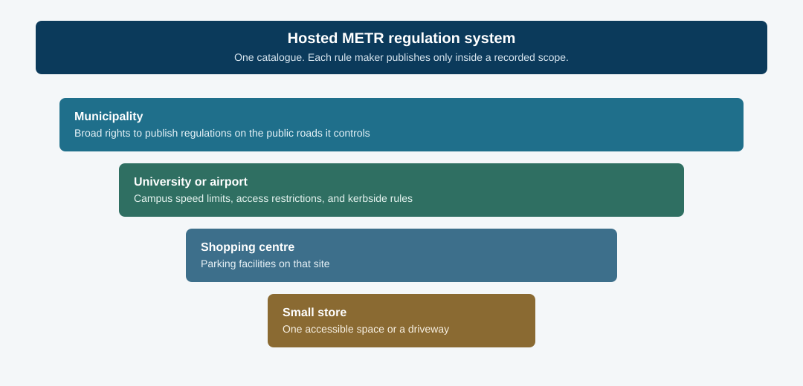
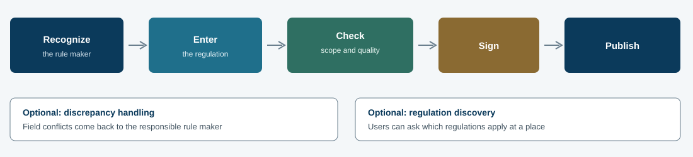

# Guidance for METR Regulation System

!!! note
    ==Audience: Deployer of METR regulation system (e.g., larger jurisdictions)==

    ==Purpose: Guidance for implementation, deployment, maintenance, and operation, including legal and cybersecurity responsibilities==
    
    ==Scope: Guidance on:==
    ==- Prerequisites and policies that need to be established/considered==
    ==- Account management & relationships that may need to be created==
    ==- Resources & capabilities needed==
    ==- Data quality & consistency, certification, certificate management==
    ==- Responsibilities of owner/operator (including any legal responsibilities)==
    ==- Sample project-level architecture, existing systems with similar or related capabilities==

This guide is for the organization that hosts the regulation system: state and local transportation agencies, their IT and policy staff, infrastructure owner-operators, and the consultants who support them. The host stores the original electronic regulations for its own jurisdictional entity and for other rule makers it recognizes. The system is responsible for providing these rules to other METR systems (primarily distribution systems) in a trustworthy electronic form.

In addition to the issues discussed on this page, stakeholders of the regulation system should also be familiar with the [system management perspective](system-management-perspective.md) for responsibilities that apply to every METR component system.

## Where the regulation system sits

The regulation system is the catalogue. Rule makers define regulations, the system checks and stores them, and distribution systems carry the signed result to users. Discrepancy reports can come back when the electronic record and the roadside disagree.

## Who may publish, and how far that authority goes

The operator's core policy job is deciding **who** may define **which** regulations **where**. Record each recognized rule maker's geographic extent, regulation categories, and any limits on temporary or emergent regulations.

### Several rule makers inside one jurisdiction

A single jurisdiction often splits the work. A municipality might assign speed limits to the road authority, parking regulations to the city manager, and emergency regulations to its response teams. The regulation system has to record each of those scopes, and how the rule makers relate, so one office cannot publish into another's authority.

### From a road network down to a single parking space

Recognition should match the risk and the responsibility. The same hosted system can serve all of these:

- A municipality in a large metropolitan area can have broad rights to publish regulations on the public roads it controls.
- A university or airport can have rights to campus speed limits, access restrictions, and kerbside regulations.
- A shopping centre can be limited to its parking facilities.
- A small store can register a single accessible parking space or a private driveway restriction.

The small entity should not need its own METR regulation system. It needs:

1. a process to become a recognized rule maker
2. credentials scoped to its authority
3. tools or services to enter, update, and retire its regulations
4. clear expectations for data quality and completeness within its defined area
5. a way to move responsibility when the property is sold or transferred

The [rule maker guide](rule-maker-perspective.md) covers how those entities prepare and enter data. The host owns the onboarding, scoping, and oversight that make that participation safe.

### Onboarding before anyone can publish

Establish a formal process to:

- verify that an applicant is a legitimate authority for the claimed facilities and regulation types
- record the legal basis and the contact points for escalation
- assign organizational identifiers used in audit and provenance metadata
- approve, suspend, or revoke recognition when ownership or responsibility changes

Campus onboarding will likely be lighter than onboarding another public agency. It still has to be deliberate: an unrecognized party must not be able to publish regulations that look authoritative to vehicles and navigation systems.

### Completeness only for a defined area

Before a regulation category is advertised as electronically trustworthy, the catalogue for that category in that area has to be necessary and sufficient for users. Support **defined areas** so completeness can be claimed in phases — speed limits on a corridor first, parking later — and so a subordinate rule maker can declare completeness only for the facilities inside its scope.

## How a regulation becomes publishable

Every regulation follows the same path on the hosted system. Optional discrepancy handling and discovery sit beside that path. They are not required to publish.

## Policies to settle before deployment

Agree these points before rule makers depend on the system. They become the operating rules the platform has to enforce.

### Who may sign, and at what certification level

Set the digital signature to use and how certificates are issued, stored, rotated, and revoked. Set the certification levels required for different regulation types (for example, testing, status quo, verified, or verified and proven). Rule makers identify the people allowed to sign, and the system has to authenticate them.

### Which regulation categories to convert first

Guide the order of conversion — speed limits, right of way, parking, or another category — so users see a consistent service across the area the system covers.

### How much notice counts as pre-announced

Define how far ahead a regulation must be available before it takes effect without being treated as emergent. Put that period in the agreement with each rule maker so they know the expectation.

### Who receives the published regulations

Decide which distributors, peer systems, and other parties the regulation system will provide regulations to.

### Which supporting-data providers are trusted

For regulations that depend on extra datasets, name the authorized providers and whether a formal agreement is required.

### What stays in-house

Decide how much of the system the host will operate and how much will be contracted, including cost, expertise, and who keeps control of recognition and signing policy.

## Optional capabilities worth turning on

These features are not required for a minimal catalogue. Each one improves trust or access and adds operational work.

### Discrepancy reporting

Field and system reports identify conflicts between electronic regulations and what is posted, or between regulations themselves. Linking the regulation system to a discrepancy handling system gives those reports somewhere to go and a path back to the responsible rule maker.

### Regulation discovery

Discovery lets a user ask which regulations apply in a specific area. That makes the catalogue easier to inspect. It also means the system must answer from the same scoped, signed data it publishes.

### Independent verification

A check by someone other than the person who entered the regulation raises confidence in accuracy. It also adds cost and another role in the workflow. Certification levels should say when that extra check is required.

## Data entry that stays inside scope

Many rule makers use one system: the host jurisdiction's own regulators, and subordinate authorities such as campuses that enter data into the parent system. Apply the recognition and scope rules at entry time. Record a confidence or certification level in the metadata of each regulation so downstream systems can see how far the data has been checked.

## Related pages

- [System management perspective](system-management-perspective.md)
- [Jurisdictional management perspective](jurisdictional-management-perspective.md)
- [Rule maker perspective](rule-maker-perspective.md)
- [Regulatory environment](regulatory-environment.md)
- [Key components](key-components.md)
